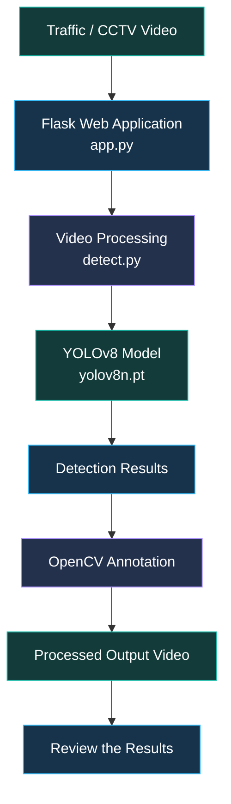

# 🚨 Emergency Vehicle Priority Detection Using YOLOv8

<p align="center">
  <strong>AI-Powered Emergency Vehicle Detection for Intelligent Traffic Monitoring</strong>
</p>

<p align="center">
  
  
  
  
</p>

---

## 📌 Table of Contents

- [Overview](#-overview)
- [Features](#-features)
- [Technology Stack](#-technology-stack)
- [System Architecture](#-system-architecture)
- [How It Works](#-how-it-works)
- [Repository Structure](#-repository-structure)
- [Installation](#-installation-and-setup)
- [Usage](#-usage)
- [Output](#-output)
- [Limitations](#-limitations)
- [Future Enhancements](#-future-enhancements)
- [Developer](#-developer)

---

## 🎯 Overview

Emergency vehicles such as ambulances, fire trucks, and police vehicles need to reach their destinations quickly. Traffic congestion can delay emergency response and create challenges for road safety.

**Emergency Vehicle Priority Detection** explores the use of Artificial Intelligence and computer vision to identify vehicles in traffic videos. It uses the YOLOv8 object detection model, OpenCV video processing, and a Flask web application to process video footage and generate annotated output.

The project demonstrates how object detection can support future intelligent traffic monitoring systems.

## ✨ Features

- 🚑 **Object Detection:** Identifies objects recognized by the configured YOLOv8 model.
- 🎥 **Video Processing:** Reads and processes video frames using OpenCV.
- 🧠 **AI Integration:** Uses the Ultralytics YOLOv8 model for object detection.
- 🌐 **Web Application:** Provides a Flask-based interface, subject to the application's implementation.
- 📹 **Annotated Output:** Supports generating a processed video with detection boxes when configured.
- 🧩 **Modular Code:** Separates application logic, detection logic, and utility functions.

## 🛠️ Technology Stack

| Technology | Purpose |
|---|---|
| Python | Main programming language |
| Flask | Web application framework |
| YOLOv8 | Object detection model |
| Ultralytics | YOLO model integration |
| OpenCV | Video and image processing |
| NumPy | Numerical and array operations, if used by the implementation |

---

## 🧩 System Architecture

The following diagram illustrates the intended processing pipeline.



> **Note:** This diagram represents the intended workflow. The exact data flow depends on how `app.py`, `detect.py`, and the utility functions are implemented.

## 🔄 How It Works

1. **Video Input:** A supported traffic or CCTV video is provided to the application.
2. **Application Handling:** The Flask application handles the input if the upload workflow is implemented.
3. **Frame Extraction:** OpenCV reads the video frame by frame.
4. **Object Detection:** YOLOv8 predicts objects based on the classes supported by the loaded model.
5. **Frame Annotation:** Detection boxes and labels can be drawn on frames.
6. **Video Generation:** The processed frames can be written into an output video.
7. **Result Review:** The annotated video can be reviewed to examine the detections.

## 📂 Repository Structure

```text
EmergencyVehiclePriorityDetection/
├── README.md
├── app.py
├── detect.py
├── utils.py
├── requirements.txt
├── yolov8n.pt
└── bus.jpg
```

- `app.py` — application entry point, if configured as such.
- `detect.py` — detection and video-processing logic.
- `utils.py` — supporting utility functions.
- `requirements.txt` — Python dependency list.
- `yolov8n.pt` — YOLOv8 model weights.
- `bus.jpg` — sample image included in the repository.

## ⚙️ Installation and Setup

### Prerequisites

- Python compatible with the dependencies in `requirements.txt`
- pip package manager
- Git
- Adequate storage for the model and input/output videos

### 1. Clone the repository

```bash
git clone https://github.com/parveenbhanu2005/EmergencyVehiclePriorityDetection.git
cd EmergencyVehiclePriorityDetection
```

### 2. Create a virtual environment

```bash
python -m venv venv
```

### 3. Activate the environment

**Windows:**

```bash
venv\Scripts\activate
```

**Linux/macOS:**

```bash
source venv/bin/activate
```

### 4. Install dependencies

```bash
python -m pip install --upgrade pip
pip install -r requirements.txt
```

### 5. Start the application

If `app.py` is configured to launch the Flask application, run:

```bash
python app.py
```

Follow the terminal output to find the local address. Flask development applications commonly use `http://127.0.0.1:5000`, but the actual address and port depend on your configuration.

If the application uses a separate detection script, follow the command and arguments defined in your code.

## ▶️ Usage

1. Install the required dependencies.
2. Start the application using its configured entry point.
3. Supply a supported video or image through the implemented input workflow.
4. Allow the detection process to run.
5. Review the generated annotations or output video, if the output workflow is configured.

## 📸 Screenshots and Demonstration

Screenshots and a demonstration video can be added here after running the application.

Recommended additions:

- Flask application interface
- Input traffic video or sample image
- YOLOv8 detection result with bounding boxes
- Annotated output video

Use genuine screenshots from the running application so visitors can evaluate the actual project.

## ⚠️ Limitations

- Detection accuracy depends on the model weights, training data, object classes, and input video quality.
- The standard YOLOv8 pretrained model does not necessarily include every emergency vehicle category as a separate class.
- Performance depends on video resolution, hardware, and inference settings.
- Emergency vehicle detection alone does not control traffic signals or guarantee road priority.
- Actual emergency response systems require extensive testing, reliability safeguards, and integration with authorized traffic infrastructure.

## 🔮 Future Enhancements

- 🚦 Integration with intelligent traffic signal systems.
- 📹 Support for live CCTV streams.
- 🚑 Improved detection using a suitable emergency-vehicle dataset.
- 🎯 Object tracking across video frames.
- 📊 Detection analytics and performance evaluation.
- ☁️ Deployment to an appropriate cloud or edge platform.
- 🔔 Alerts and monitoring for authorized traffic-management workflows.

## 👨‍💻 Developer

**B. Parveen Bhanu**

B.Tech — Computer Science Engineering (Cyber Security)  
Rajeev Gandhi Memorial College of Engineering & Technology, Andhra Pradesh

- **GitHub:** [parveenbhanu2005](https://github.com/parveenbhanu2005)
- **LinkedIn:** [Connect with me](https://www.linkedin.com/in/parveen-bhanu-bandisula/)
- **Portfolio:** [Visit my portfolio](https://parveenbhanu-portflio.netlify.app/)

---

<p align="center">
  <strong>Learning continuously. Building consistently. Improving every day.</strong>
</p>

<p align="center">
  🚀 Exploring AI and computer vision for smarter traffic monitoring.
</p>
